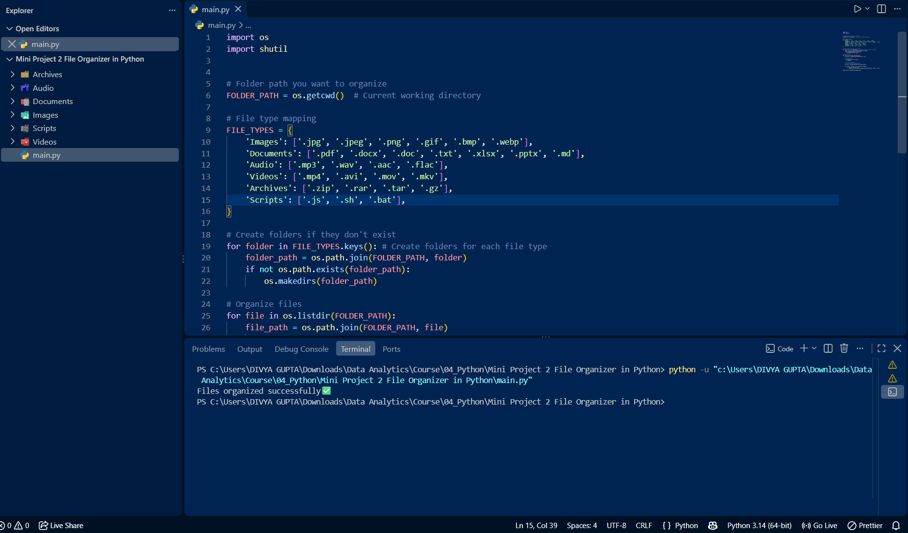

# 📂 Python File Organizer

A simple Python automation project that organizes files into separate folders based on their file extensions.

## 📌 About the Project

The File Organizer scans a directory, identifies files by their extensions, creates category folders, and moves matching files into the appropriate folders automatically.

## 🛠️ Technologies Used

- Python 3
- `os` module
- `shutil` module

## ✨ Features

- Automatically creates category folders.
- Organizes PDF documents, Word files, images, videos, and text files.
- Identifies file extensions automatically.
- Uses Python's built-in modules for file management.

## 📁 Folder Categories

| Folder | File Types |
|---|---|
| PDFs | `.pdf` |
| Word_Files | `.docx`, `.doc` |
| Images | `.jpg`, `.jpeg`, `.png` |
| Videos | `.mp4`, `.mkv` |
| Text_Files | `.txt` |

## 🚀 How to Run

1. Install [Python 3](https://www.python.org/downloads/).

2. Clone this repository:
   ```bash
   git clone https://github.com/DIVYA-14a/Python-File-Organizer.git
   ```

3. Open the downloaded project folder in Visual Studio Code.

4. Open the terminal in VS Code.

5. Run the script:
   ```bash
   python file_organizer.py
   ```


## 📚 What I Learned

- File and directory handling in Python.
- Working with file extensions.
- Using the `os` and `shutil` modules.
- Automating repetitive tasks.

## 📸 Screenshot



## 👩‍💻 Author

**Divya Gupta**

- GitHub: [DIVYA-14a](https://github.com/DIVYA-14a)
- LinkedIn: [Divya Gupta](https://www.linkedin.com/in/divya-gupta-803a14295/)

---

⭐ If you find this project useful, consider giving the repository a star!
